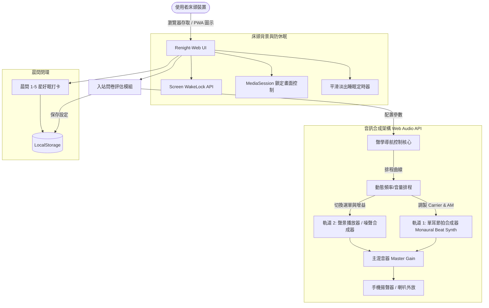

# Renight-Web: 腦波同步助眠 PWA 系統設計規格書 (Design Document)

## 1. 背景與核心意圖 (Intent & The Why)
使用者面臨睡眠困擾（入睡困難、淺眠易醒），希望打造類似 **Renight (Nightly)** 核心機制的軟體。
因考量到 App Store 開發者帳號年費（$99 USD/年）與審核成本，本專案定位為**零成本、可在手機（iOS Safari / Android Chrome）與電腦瀏覽器床頭外放運行的漸進式網頁應用 (PWA)**。

Renight 的核心是**單耳節拍 (Monaural Beats)** 腦波同步技術。不同於必須配戴立體聲耳機的雙耳節拍 (Binaural Beats)，單耳節拍是由兩個相近頻率的聲波在單一發聲單元或真實空氣中產生實體振幅調製 (Acoustic Amplitude Modulation)，床頭手機或喇叭外放即可直接作用於聽覺神經系統，引導大腦由活躍狀態過渡至 Theta (4–8 Hz) 放鬆入睡波與 Delta (0.5–4 Hz) 慢波深睡狀態。

---

## 2. 目標、非目標與反向目標 (Goals, Non-Goals, Anti-Goals)

### 目標 (Goals)
1. **入站問卷評估 (Sleep Onboarding Questionnaire)**：
   * 首次進入時填寫個人化睡眠評估：主要困擾（入睡困難 vs 淺眠易醒）、目標睡眠時長（30/45/60/90分鐘/全夜）、偏好聲景。
   * 依據表單結果自動計算並推薦「腦波降頻引導曲線」與預設參數。
2. **純助眠播放器定位 (Pure Sleep-Aid Player)**：
   * 專注於陪伴入睡與深睡維持；定時器結束前 10 分鐘進行平滑指數漸弱淡出（Gain Fade-out）並釋放音訊資源，起床交由手機系統原生鬧鐘（最穩定省電、零掛起失誤風險）。
3. **Web Audio API 物理聲波合成引擎 (Real-time Monaural Beats Engine)**：
   * 無損實時數學合成，無需串流大型音訊，節省頻寬與流量。
   * 基頻（Carrier Frequency）：108 Hz – 150 Hz 的柔和溫暖正弦波。
   * 調製波（Modulation Frequency）：
     * **Alpha (8–12 Hz)**：閉目放鬆。
     * **Theta (4–8 Hz)**：入睡過渡期、冥想、雜念消除。
     * **Delta (0.5–4 Hz)**：深層慢波睡眠（SWS）。
   * 時間曲線控制：動態從 Alpha 漸進調降至 Theta 與 Delta。
4. **雙軌聲景混音器 (Dual-Track Soundscape Mixer)**：
   * **軌道 1 (Track 1)**：單耳節拍物理合成器（Carrier + AM 調製，獨立音量滑桿）。
   * **軌道 2 (Track 2)**：舒緩環境聲景（多選一：窗邊細雨、溫暖柴火、演算法粉紅噪音、演算法棕色噪音、或靜音，獨立音量滑桿）。
   * 主音量與睡眠定時器（支援定時結束前漸弱淡出）。
5. **床頭沉浸模式與防休眠機制 (Bedside Mode & Mobile Optimization)**：
   * OLED 極黑夜間介面（True Black `#000000`，超低亮度微光時鐘，防藍光阻礙褪黑激素）。
   * 支援 Screen WakeLock API（可選擇是否保持微光時鐘常亮）。
   * 支援 Web `MediaSession` API 與行動端背景音訊防掛起機制。
6. **本地持久化與狀態記憶 (Local Storage Persistence)**：
   * 即使部署於 GitHub Pages 靜態網站，透過瀏覽器標準 `localStorage` 技術，資料直接牢固保存在使用者手機/電腦的瀏覽器中。
   * **首次使用**：填寫入站問卷。
   * **後續開啟**：自動跳過問卷、秒進專屬「今日好眠計畫」主畫面，所有參數與自訂設定完全保留，並保留「重新設定」按鈕供隨時修改。
7. **極致響應式設計 (Mobile-First RWD & Safe Areas)**：
   * 採用移動端優先（Mobile-First）排版，專注於手機床頭單手操作與夜間閱覽體驗，並流暢適配電腦螢幕。
   * 嚴格處理行動端瀏覽器視口問題（使用 `100dvh` 防止網址列伸縮造成版面跳動，適配 iOS 瀏海與底部指示條 `env(safe-area-inset-*)`）。
   * 所有按鈕皆符合人體工學觸控熱區（手指好按、避免誤觸）。
8. **專業視覺與無 Emoji 規範 (No-Emoji Minimalist Aesthetic)**：
   * **嚴格禁止使用 Emoji**（杜絕廉價 AI 感）。
   * 全站圖標採用精緻極簡線性 SVG 圖示（如播放、暫停、音波、月相、細雨等專業幾何線條），營造如 Renight、Endel、Oura 的專業神經聲學科技感。

### 非目標 (Non-Goals)
* 不承擔「鬧鐘強行喚醒責任」（由使用者手機系統原生鬧鐘負責）。
* 不開發原生 iOS/Android 二進制安裝包（不提交 App Store/Google Play）。
* 不建置雲端資料庫與使用者帳號登入系統。
* 不串接智慧手環/手錶硬體（Apple Watch, Garmin 等）。

### 反向目標 (Anti-Goals)
* **嚴禁強迫配戴耳機**：所有聲波計算必須為單聲道/立體聲相干之實體單耳振幅調製，外放即可有效。
* **嚴禁任何高頻突發音訊**：不可包含大於 1000 Hz 的刺耳高頻噪聲或突兀彈窗提示。
* **嚴禁刺眼 UI 與花俏動效**：禁止明亮白色介面、高飽和度強光色彩或頻繁動畫。
* **嚴禁在 UI 中出現 Emoji**：所有介面嚴格使用純文字或高質感 SVG 向量符號。

---

## 3. 限制條件 (Constraints)
* **零伺服器成本**：完全作為靜態資源部署（如 GitHub Pages, Vercel 或純本地開箱即用）。
* **行動端瀏覽器限制**：
  * iOS Safari 音訊自動播放限制（Autoplay Policy）：必須由使用者明確的「點擊開始 (Tap to Start)」手勢解鎖 Web Audio `AudioContext`。
  * iOS 螢幕鎖定音訊掛起：定時播放期間透過 `HTMLAudioElement` 連續音訊或 `MediaSession` 保持活躍；定時結束後平順關閉。

---

## 4. 方案取捨評估 (Approaches Evaluated)

| 方案 | 架構描述 | 優點 | 缺點 / 代價 | 結論 |
| :--- | :--- | :--- | :--- | :--- |
| **方案 A (選定)** | **雙軌混音 PWA** (Web Audio 實體單耳節拍 + 自然聲景 + 動態導航曲線) | 聽感舒適自然、結合科學與聽覺舒適度、完全免費、支援 PWA 主畫面全螢幕運作 | 需整合少量輕量音訊資源 | **採用**：最貼近 Renight 商業級體驗且零成本 |
| **方案 B** | **極簡物理合成器** (純 Web Audio 振幅調製 + 純演算法噪聲) | 零外部音訊資源、單一 HTML 檔案 | 缺乏真實自然雨聲/風聲，純電音調製容易單調 | 放棄 |
| **方案 C** | **全端雲端應用** (Next.js + 雲端資料庫) | 可跨裝置同步睡眠數據報表 | 架構笨重、有伺服器維護與成本開銷 | 放棄 |

---

## 5. 詳細功能與模組架構設計 (Detailed Architecture)

### 5.1 入站睡眠問卷模組 (Sleep Onboarding Questionnaire)
* **題目 1：主要睡眠困擾**
  * 選項 A: **入睡困難**（躺床 30 分鐘以上翻來覆去、腦袋停不下來）。
    * *預設曲線*：Alpha (10 Hz) -> Theta (5.5 Hz) -> Delta (2 Hz)，30–45 分鐘漸進降頻，結束前 10 分鐘平滑淡出。
  * 選項 B: **淺眠易醒**（半夜容易醒來、稍有動靜即驚醒）。
    * *預設曲線*：穩定 Delta (1.8 Hz) + 棕色噪音（低頻能量集中）長時播放，阻絕夜間突發環境雜音。
* **題目 2：預設播放時長**
  * 選項：30 分鐘、45 分鐘、60 分鐘、90 分鐘（完整循環）、持續播放（全夜）。
* **題目 3：偏好環境聲景**
  * 選項：窗邊細雨 (Rain)、溫暖壁爐 (Fireplace)、深空粉紅噪音 (Pink Noise)、低頻棕色噪音 (Brown Noise)、純淨無聲（僅節拍）。

### 5.2 雙軌混音與聲學演算法 (Audio Engine & Physics)
* **Track 1（單耳節拍）**：
  $$S_1(t) = [1 + m \cdot \sin(2\pi \Delta f(t) t)] \cdot \sin(2\pi f_c t)$$
  * $f_c$：110–136 Hz 溫暖正弦波（單純柔和、無刺耳泛音）。
  * $\Delta f(t)$：隨睡眠階段由 10 Hz 動態降至 2 Hz。
  * $m$：調製深度（預設 0.7）。
* **Track 2（環境聲景）**：
  * 若選擇自然音（雨聲、壁爐）：播放高品質無縫循環 Audio Buffer。
  * 若選擇噪聲（粉紅/棕色）：由 Web Audio API 濾波合成（BiquadFilterNode -12dB/octave 滾降），完全由演算法實時渲染。
* **主混音**：提供「腦波強度」與「聲景音量」兩顆獨立比例滑桿，並在倒數 10 分鐘透過 `linearRampToValueAtTime` 進行無感知漸弱釋放。

### 5.3 介面與床頭防藍光設計 (UI/UX Specification)
* **色彩規範**：
  * 背景：`#000000` (純黑，OLED 像素不發光)。
  * 主文字：`#8A99A8` (低刺激夜間冷灰藍)。
  * 強調色：`#3D5A80` 與柔和微光暈。
* **畫面狀態機**：
  1. **問卷引導態 (Onboarding)**：首次載入或點擊「重設睡眠偏好」時呈現，3 題卡片滑動選擇。
  2. **主控態 (Dashboard)**：呈現今日推薦計畫（時長、預期波段、聲景組合）、一鍵「開始入眠」大按鈕、微調滑桿。
  3. **床頭暗屏態 (Bedside Clock)**：播放後自動進入，只顯示極暗數字時鐘、剩餘時間、輕觸喚醒與暫停鍵，支援螢幕常亮開關。
  4. **晨間打卡態 (Morning Card)**：隔日重啟時若有前次紀錄，彈出 1–5 星簡短心情評估，一鍵完成並儲存。

---

## 6. 技術棧與工程選型 (Tech Stack & Implementation)
* **建置工具**：Vite + Vanilla TypeScript (或 React + Tailwind CSS)，輕巧零負擔。
* **音訊核心**：Web Audio API (純原生效能，無額外重量級第三方程式庫)。
* **PWA 支援**：`manifest.json` + `service-worker.js`，支援離線快取與加入手機主畫面。
* **裝置保活**：`navigator.wakeLock`、`navigator.mediaSession`、短循環音訊緩衝防休眠。
* **專案路徑**：`C:\Users\mike9\OneDrive - National Pingtung University\桌面\PROJECT\renight-web`。

---

## 7. 交付給建構者之邊界 (What's Left to the Builder)
1. 具體 Web Audio 節點網路連線代碼實現（OscillatorNode, GainNode, BiquadFilterNode, AudioBufferSourceNode）。
2. 自然音景雨聲/壁爐無縫音訊之打包與離線快取策略。
3. 行動端觸摸解鎖 AudioContext 之流程。
